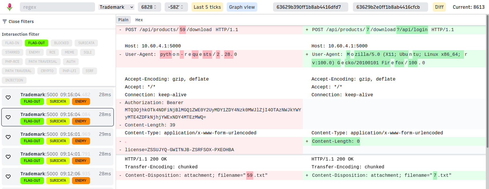

# 🌸 Petal

Petal is a flow analyzer for Attack / Defence CTF competitions, ready to run on a vulnbox. It lets players quickly find the traffic hitting their services, spot flags and exploits, and generates python snippets to replay attacks.

Petal is based on [Tulip](https://github.com/OpenAttackDefenseTools/tulip) (see [Credits](#credits)) and adds:
* `install.sh`: one script to install, update, build and run it; the rest is set up in the browser
* Team password login, and a setup / Settings page in the dashboard (services, capture, VPN range, game)
* Status page: capture health (last packet, imports), flows per service, container states, current settings
* Capture container: rotating `tcpdump` on one or more interfaces, flows appear ~1 minute after traffic stops
* Services running in Docker on the box are picked from a list and resolved to their container IP:port and
  every Docker network they use (traffic through tunnels and reverse proxies is captured too)
* Attacker IP tags `src:<ip>` for requests that came through nginx/tunnels, optionally limited to the VPN range
* Dashboard on a chosen IP and port (free port detected)

Install on a box:
```
curl -fsSL https://raw.githubusercontent.com/aimansam/petal/main/install.sh | bash
```
It asks for a team password (or prints a generated one), starts Petal and shows the URL: open it, log in and
finish the setup page. Re-running it (or `./install.sh` inside the `petal` folder) updates Petal.
To remove it from Docker: `./clean.sh` (it asks before removing anything, and whether to delete the pcaps), then delete the folder.

## Origins
Petal is based on Tulip. Tulip was developed by Team Europe for use in the first International Cyber Security Challenge. The project is a fork of [flower](https://github.com/secgroup/flower), but it contains quite some changes:
* New front-end (typescript / react / tailwind)
* New ingestor code, based on gopacket
* IPv6 support
* Vastly improved filter and tagging system.
* Deep links for easy collaboration
* Added an http decoding pass for compressed data
* Synchronized with Suricata.
* Flow diffing
* Time and size-based plots for correlation.
* Linking HTTP sessions together based on cookies (Experimental*, disabled by default)
* PCAP-over-IP with BPF filtering support**

\* - to enable, add `-experimental` after `./assembler` in `docker-compose.yml`

\*\* - to enable, configure PCAP-over-IP server (e.g. [pcap-broker](https://github.com/fox-it/pcap-broker) as suggested in [PR 24](https://github.com/OpenAttackDefenseTools/tulip/pull/24)) and set `PCAP_OVER_IP` (and `BPF` if necessary) in `.env`

## Screenshots




## Quick start (fresh box)

```
git clone https://github.com/aimansam/petal.git && cd petal
./install.sh
```

`install.sh` installs Docker if it is missing (Debian/Ubuntu), asks for the team password (in a terminal;
otherwise it generates one and prints it once), builds and starts everything. Then open the printed URL, log in
and use the setup page: pick the services to watch from the running containers, check the network, VPN range and
game settings, and apply. The same page is **Settings** in the dashboard header later on (including a password
change). The **Status** page shows whether capture and imports are working, flows per service in the last
hour and the state of every container. Applying is done by a small `setup` helper container; it has Docker access but no network port, and the
dashboard can only reach it through the API's logged-in `/setup/*` routes.

A `capture` container runs `tcpdump` on the host and rotates pcaps into `./traffic`, which Petal imports automatically.
Requests that reach a service through a reverse proxy (nginx, a tunnel) are tagged `src:<attacker ip>`, taken from
`X-Forwarded-For`/`X-Real-IP`/`CF-Connecting-IP` (only the containers on the services' networks are trusted).

Both scripts take no arguments. For an unattended install, preset the settings in the environment and run it
without a terminal: `SERVICES="web:8080,pwn:1337" ./install.sh </dev/null` (the generated password is printed).

Day-to-day commands (run in the `petal` folder):
```
docker compose ps                          # containers
docker compose logs -f assembler capture   # follow imports and capture
docker compose stop                        # stop everything (./install.sh starts it again)
./clean.sh                                 # remove Petal from Docker (asks first; pcaps optional)
```

## Configuration
Services shown in the UI are set with `SERVICES` in `.env`, as `name:port` (ip = `VM_IP`) or `name:ip:port`, comma separated:
```
SERVICES="BIOMarkt:18080,SaaS:5555"
```

You can also edit this during the CTF, then recreate the `api` service:
```
docker compose up -d api
```

## Usage

The stack can be started with docker-compose, after creating an `.env` file. See `.env.example` as an example of how to configure your environment.
```
cp .env.example .env
# < Edit the .env file with your favourite text editor >
docker-compose up -d --build
```
To ingest traffic, it is recommended to create a shared bind mount with the docker-compose. One convenient way to set this up is as follows:
1. On the vulnbox, start a rotating packet sniffer (e.g. tcpdump, suricata, ...)
```bash
tcpdump -i eth0 -G 180 -w "traffic_%H:%M:%S.pcap" port 8080
```
2. Using rsync, copy complete captures to the machine running Petal (e.g. to /traffic)
```bash
rsync -avz -e ssh --progress root@10.0.0.2:/pcaps ./pcaps
```
3. Add a bind to the assembler service so it can read /traffic
   > (Just change `TRAFFIC_DIR_HOST` in `.env`)

The ingestor will use inotify to watch for new pcap's. No need to set a chron job.


## Tag rules
Petal tags every new flow that matches one of your rules, next to the built-in `flag-in`/`flag-out` and
`src:<ip>` tags. Edit them on the **Settings** page (saved to `rules/tag-rules.conf`, applied within a few
seconds, no restart). One rule per line:
```
sqli = (?i)union(\s|%20|\+)+select        # what the client sent
leak-passwd @out = root:x:0:0:           # what the service answered
recipe-sqli = /search\?q=.*union          # an exploit you just spotted
```
Tags use `a-z 0-9 _ -`, regexes are Go/RE2 (`(?i)` ignores case). Rules see the whole request (headers and
body, also POST/JSON/multipart); JSON escapes are decoded before matching, so `"127.0.0.1\\u003bcat /flag"`
is caught like `;cat /flag`, and the starter rules also match URL-encoded forms. Starter rules for SQL injection, path
traversal, command and template injection, XSS and `/etc/passwd` leaks ship in
`rules/tag-rules.default.conf`. Tip: when you find an exploit in the traffic, add a rule for it to see every
later attempt, who sends it and whether your patch holds.

# Security
Your Petal instance will probably contain sensitive CTF information, like flags stolen from your machines. If you expose it to the internet and other people find it, you risk losing additional flags. It is recommended to host it on an internal network (for instance behind a VPN) or to put Petal behind some form of authentication.

# Contributing
If you have an idea for a new feature, bug fixes, UX improvements, or other contributions, feel free to open a pull request or create an issue!      

# Credits
Petal is maintained by [@aimansam](https://github.com/aimansam) and is a modified version of Tulip (GPL-3.0, see [NOTICE](NOTICE)).

Tulip was written by [@RickdeJager](https://github.com/rickdejager) and [@Bazumo](https://github.com/bazumo), with additional help from [@Sijisu](https://github.com/sijisu). Thanks to our fellow Team Europe players and coaches for testing, feedback and suggestions. Finally, thanks to the team behind [flower](https://github.com/secgroup/flower) for opensourcing their tooling.
