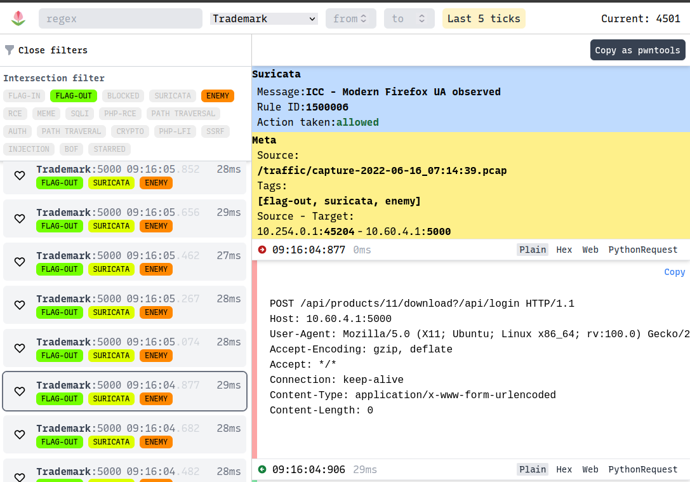
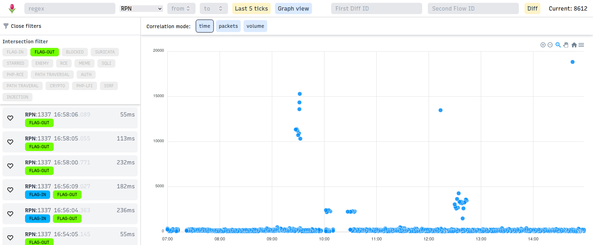

# 🌸 Petal

Petal is a flow analyzer for Attack / Defence CTF competitions, ready to run on a vulnbox. It lets players quickly find the traffic hitting their services, spot flags and exploits, and generates python snippets to replay attacks.

Petal is based on [Tulip](https://github.com/OpenAttackDefenseTools/tulip) (see [Credits](#credits)) and adds:
* `install.sh`: one script to install, configure, build and run it (Docker, `.env`, updates)
* Capture container: rotating `tcpdump` on one or more interfaces, flows appear ~1 minute after traffic stops
* Services running in Docker on the box are picked from a list and resolved to their container IP:port and
  every Docker network they use (traffic through tunnels and reverse proxies is captured too)
* Attacker IP tags `src:<ip>` for requests that came through nginx/tunnels, optionally limited to the VPN range
* Dashboard on a chosen IP and port (free port detected)

Install on a box:
```
curl -fsSL https://raw.githubusercontent.com/aimansam/petal/main/install.sh | bash
```
Re-running it (or `./install.sh` inside the `petal` folder) updates Petal and re-runs the setup.
To remove it from Docker (containers, database, images; pcaps and `.env` are kept): `./clean.sh`
(`./clean.sh --pcaps` also deletes the captures), then delete the folder.

## Origins
Petal is based on Tulip. Tulip was developed by Team Europe for use in the first International Cyber Security Challenge. The project is a fork of [flower](https://github.com/secgroup/flower), but it contains quite some changes:
* New front-end (typescript / react / tailwind)
* New ingestor code, based on gopacket
* IPv6 support
* Vastly improved filter and tagging system.
* Deep links for easy collaboration
* Added an http decoding pass for compressed data
* Synchronized with Suricata.
* Flow diffing
* Time and size-based plots for correlation.
* Linking HTTP sessions together based on cookies (Experimental*, disabled by default)
* PCAP-over-IP with BPF filtering support**

\* - to enable, add `-experimental` after `./assembler` in `docker-compose.yml`

\*\* - to enable, configure PCAP-over-IP server (e.g. [pcap-broker](https://github.com/fox-it/pcap-broker) as suggested in [PR 24](https://github.com/OpenAttackDefenseTools/tulip/pull/24)) and set `PCAP_OVER_IP` (and `BPF` if necessary) in `.env`

## Screenshots




## Quick start (fresh box)

```
git clone https://github.com/aimansam/petal.git && cd petal
./install.sh
```

`install.sh` installs Docker if it is missing (Debian/Ubuntu), asks for your vulnbox IP, services,
capture interface and game timing (sensible defaults are detected), writes `.env`, then builds and starts everything.
A `capture` container runs `tcpdump` on the host and rotates pcaps into `./traffic`, which Petal imports automatically.
The web UI is on port 3000 (`UI_PORT` in `.env`; setup picks a free port if 3000 is taken), on all IPs or only the one set in `UI_BIND` (e.g. the competition network IP).
Requests that reach a service through a reverse proxy (nginx, a tunnel) are tagged `src:<attacker ip>`, taken from
`X-Forwarded-For`/`X-Real-IP`/`CF-Connecting-IP` (install.sh trusts only the containers on the services' networks); set `VPN_RANGES` to tag only competition VPN addresses).

```
./install.sh -y       # non-interactive, keep defaults / current .env values
./install.sh status   # containers, pcap count, flows in the database
./install.sh logs     # follow the assembler + capture logs
./install.sh stop     # stop everything
./install.sh reset    # wipe the database (pcaps are kept)
```

Re-run `./install.sh` at any time to change settings. Values can be preset from the environment:
`SERVICES="web:8080,pwn:1337" CAPTURE_IFACE=eth0 ./install.sh -y`

## Configuration
Services shown in the UI are set with `SERVICES` in `.env`, as `name:port` (ip = `VM_IP`) or `name:ip:port`, comma separated:
```
SERVICES="BIOMarkt:18080,SaaS:5555"
```

You can also edit this during the CTF, then recreate the `api` service:
```
docker compose up -d api
```

## Usage

The stack can be started with docker-compose, after creating an `.env` file. See `.env.example` as an example of how to configure your environment.
```
cp .env.example .env
# < Edit the .env file with your favourite text editor >
docker-compose up -d --build
```
To ingest traffic, it is recommended to create a shared bind mount with the docker-compose. One convenient way to set this up is as follows:
1. On the vulnbox, start a rotating packet sniffer (e.g. tcpdump, suricata, ...)
```bash
tcpdump -i eth0 -G 180 -w "traffic_%H:%M:%S.pcap" port 8080
```
2. Using rsync, copy complete captures to the machine running Petal (e.g. to /traffic)
```bash
rsync -avz -e ssh --progress root@10.0.0.2:/pcaps ./pcaps
```
3. Add a bind to the assembler service so it can read /traffic
   > (Just change `TRAFFIC_DIR_HOST` in `.env`)

The ingestor will use inotify to watch for new pcap's and suricata logs. No need to set a chron job.


## Suricata synchronization

### Run in Docker

Configure `SURICATA_DIR_HOST` in `.env`.

Create some rules (404 for testing):
```bash
. .env
mkdir -p ${SURICATA_DIR_HOST}/{etc,lib/rules,log}
echo 'alert tcp any any -> any any (msg: "404 Not Found"; http.stat_code; content:"404"; metadata: tag notfound; sid:4; rev: 1;)' >> ${SURICATA_DIR_HOST}/lib/rules/suricata.rules
```

After that run (default config for `eve.json` logging was good enough):

```bash
docker compose -f docker-compose-suricata.yml up -d --build
```

### Metadata
Tags are read from the metadata field of a rule. For example, here's a simple rule to detect a path traversal:
```
alert tcp any any -> any any (msg: "Path Traversal-../"; flow:to_server; content: "../"; metadata: tag path_traversal; sid:1; rev: 1;)
```
Once this rule is seen in traffic, the `path_traversal` tag will automatically be added to the filters in Petal.

> [!NOTE]
>
> After editing Suricata rules (renaming or id change) please:
>
> Remove old logs: `rm ${SURICATA_DIR_HOST}/log/*` (otherwise old signatures will be repopulated).
>
> Restart Docker containers.
>
> If database was only restarted (not dropped), try cleaning tags/signatures manually.

### eve.json
Suricata alerts are read directly from the `eve.json` file. Because this file can get quite verbose when all extensions are enabled, it is recommended to strip the config down a fair bit. For example:
```yaml
# ...
  - eve-log:
      enabled: yes
      filetype: regular #regular|syslog|unix_dgram|unix_stream|redis
      filename: eve.json
      pcap-file: false
      community-id: false
      community-id-seed: 0
      types:
        - alert:
            metadata: yes
            # Enable the logging of tagged packets for rules using the
            # "tag" keyword.
            tagged-packets: yes
# ...
```

Sessions with matched alerts will be highlighted in the front-end and include which rule was matched.

# Security
Your Petal instance will probably contain sensitive CTF information, like flags stolen from your machines. If you expose it to the internet and other people find it, you risk losing additional flags. It is recommended to host it on an internal network (for instance behind a VPN) or to put Petal behind some form of authentication.

# Contributing
If you have an idea for a new feature, bug fixes, UX improvements, or other contributions, feel free to open a pull request or create an issue!      

# Credits
Petal is maintained by [@aimansam](https://github.com/aimansam) and is a modified version of Tulip (GPL-3.0, see [NOTICE](NOTICE)).

Tulip was written by [@RickdeJager](https://github.com/rickdejager) and [@Bazumo](https://github.com/bazumo), with additional help from [@Sijisu](https://github.com/sijisu). Thanks to our fellow Team Europe players and coaches for testing, feedback and suggestions. Finally, thanks to the team behind [flower](https://github.com/secgroup/flower) for opensourcing their tooling.
